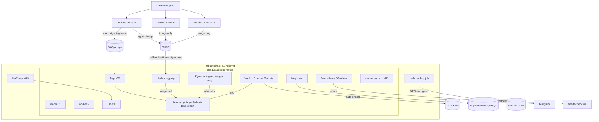

# talos-kvm: a production-style Kubernetes lab on one machine

An on-premise Kubernetes platform built and operated during my internship at VTC Intecom (from 10/2026),
with the brief "run it like production". Everything runs on a single Ubuntu host with one HDD,
plus a few free or credit-funded cloud services.

This repository documents the design, the operating model and the lessons learned.
The live GitOps repository is private; snippets here are sanitized (no hosts, keys or account IDs).

## Architecture

## What is in it

| Area | Choice | Why |
|---|---|---|
| OS | Talos Linux | Immutable, API-only nodes. No SSH, no drift. |
| Delivery | Argo CD app-of-apps, self-heal | Git is the only way to change the cluster. |
| Secrets | Sealed Secrets for infrastructure, Vault + External Secrets for app config | Encrypted secrets can live in Git; app values are rotated in Vault without a commit. |
| Releases | Argo Rollouts blue-green + analysis | New version is checked before it gets traffic. |
| Identity | Keycloak OIDC/SAML for 8 tools, each with a break-glass account | One login, one place to revoke access. |
| Database | Keycloak DB on managed PostgreSQL | Moves stateful load off the single HDD. Rollback plan kept. |
| CI | Jenkins deploys; GitHub Actions and GitLab CE only build | Three CI systems compared on one app; Jenkins chosen for production. |
| Supply chain | gitleaks, govulncheck, gosec, SonarQube, Trivy, SBOM, cosign; Kyverno admits only signed images; ZAP scans the preview | Every gate was proven by a deliberately bad commit or image. |
| Registry | Self-hosted Harbor, pull-replicated from GHCR with signatures | Image pulls stay inside the network; ghcr remains the source of truth. |
| Monitoring | Prometheus, Alertmanager to Telegram | Catches problems while the cluster is alive. |
| Dead man's switch | healthchecks.io pings from host and VMs | Catches the case where nothing is alive to alert. |
| Backup | etcd snapshot, DB dump, GitLab backup, GPG, B2 | Offsite and encrypted; decryption is tested, not assumed. |
| Cost | VMs run only 45 of 168 h/week, budget alerts | ~70% less compute spend on cloud credit. |

## Operating model

- Every change is a commit. Rollback is `git revert <specific commit>`, never `HEAD^`.
- A runbook covers daily start-up, shutdown order, backup checks and known failures.
- Risky changes get a written plan with a rollback path, and the rollback is rehearsed.
- Incidents are written up: what broke first, what failed as a consequence, how it was found.

## Lessons learned

1. **One HDD is the real limit.** etcd, Prometheus and image pulls compete for ~128 IOPS.
   Fewer control-plane nodes and moving the database off-host helped more than adding RAM.
2. **External dependencies fail together.** The office network uses a captive portal; when it expires,
   SSO, backups and image pulls all fail at once. The start-up runbook now begins with the portal.
3. **Self-heal undoes manual fixes.** Planned cutovers pause automated sync first, then re-enable it.
4. **Revert by hash.** A `git revert HEAD^` once reverted a CI deploy commit instead of the intended change.
5. **A backup is only real after a restore test.** Each new backup path was decrypted end to end before being trusted.
6. **Monitor the monitor.** In-cluster alerting cannot report its own death; an external heartbeat can.
7. **Rehearse the rollback, both ways.** A drill moved Keycloak back to its local database and then forward
   to managed PostgreSQL again (see below). The way back worked first time; the way forward exposed a real gap.
8. **"It works" is not "every path works".** Harbor served the web UI and replicated images for a day while its
   token endpoint returned 500: the token-signing key was PKCS#8 (OpenSSL 3 default) and Harbor only reads PKCS#1.
   It surfaced only when the first real registry client (Kyverno) asked for a token. Now every new component is
   tested through the path its consumers actually use.
9. **Auto-unseal moves the dependency, it does not remove it.** Vault unseals itself with GCP KMS, so a morning
   without Internet left it sealed and every app secret stale. An alert now fires when Vault stays unready.

## Measured (28/10)

| What | Time |
|---|---|
| Cold start: control plane powered on to every app Synced/Healthy and every pod Ready | 9 min 29 s |
| Push to production: commit, Jenkins pipeline with all gates, Harbor replication, blue-green with ZAP | ~12 min |
| Image pull from in-cluster Harbor | 4.5 to 7 s |

## Rollback drill: Keycloak database (27/10)

| Step | Change | SSO downtime | Result |
|---|---|---|---|
| Roll back to local PostgreSQL | `git revert` of the cutover commit | 3 min 23 s | Login works on the old data |
| Roll forward to Supabase | `git revert` of the rollback | ~13 min | Stuck rollout, fixed by deleting the pod |

What went wrong on the way forward: the same commit scaled the local database to zero and changed
Keycloak's database settings. The old Keycloak pod lost its database and became unready before the
StatefulSet replaced it. With `podManagementPolicy: OrderedReady`, a StatefulSet does not replace a pod
that is not Ready, so the rollout stalled. Deleting the pod let the new revision start.
Most of the 13 minutes was detection time; the fix itself took under 2 minutes.

Changes made after the drill:
- The runbook now checks `currentRevision` against `updateRevision` and deletes the pod if it stays unready for 3 minutes.
- Next time, split the change into two commits: switch the app first, wait for Ready, then scale the old database down.

## Docs

- [Architecture notes](docs/architecture.md)
- [CI comparison](docs/ci-comparison.md)

## Stack

Talos Linux, Kubernetes, KVM/libvirt, Argo CD, Argo Rollouts, Sealed Secrets, Traefik, cert-manager,
Keycloak, Vault, External Secrets, Harbor, Kyverno, cosign, Trivy, SonarQube, OWASP ZAP, Prometheus, Grafana,
Alertmanager, GitHub Actions, Jenkins, GitLab CE, Docker, Google Cloud,
Supabase, Backblaze B2, Bash.
