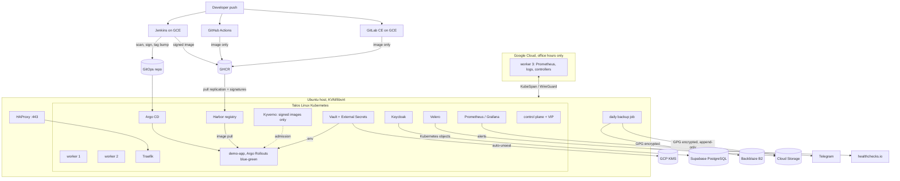

# talos-kvm: a production-style Kubernetes lab on one machine

An on-premise Kubernetes platform built and operated during my internship at VTC Intecom (from 10/2026),
with the brief "run it like production". The cluster runs on a single Ubuntu host with one HDD,
plus one cloud worker joined over WireGuard and a few free or credit-funded cloud services.

This repository documents the design, the operating model and the lessons learned.
The live GitOps repository is private; snippets here are sanitized (no hosts, keys or account IDs).

## Architecture

## What is in it

| Area | Choice | Why |
|---|---|---|
| OS | Talos Linux | Immutable, API-only nodes. No SSH, no drift. |
| Delivery | Argo CD app-of-apps, self-heal | Git is the only way to change the cluster. |
| Secrets | Sealed Secrets for infrastructure, Vault + External Secrets for app config | Encrypted secrets can live in Git; app values are rotated in Vault without a commit. |
| Releases | Argo Rollouts blue-green + analysis | New version is checked before it gets traffic. |
| Identity | Keycloak OIDC/SAML for 10 tools, each with a break-glass account | One login, one place to revoke access. |
| Capacity | A cloud worker joined over KubeSpan (WireGuard), tainted so only chosen workloads land there | Moves Prometheus, logs and controllers off the HDD host; nothing that needs internal DNS goes there. |
| Database | Keycloak DB on managed PostgreSQL | Moves stateful load off the single HDD. Rollback plan kept. |
| CI | Jenkins deploys; GitHub Actions and GitLab CE only build | Three CI systems compared on one app; Jenkins chosen for production. |
| Supply chain | gitleaks, govulncheck, gosec, SonarQube, Trivy, SBOM, cosign; Kyverno admits only signed images; ZAP scans the preview | Every gate was proven by a deliberately bad commit or image. |
| Registry | Self-hosted Harbor, pull-replicated from GHCR with signatures | Image pulls stay inside the network; ghcr remains the source of truth. |
| Monitoring | Prometheus, Alertmanager to Telegram; OpenTelemetry Collector to VictoriaLogs for central logs | Catches problems while the cluster is alive; one place to search every pod log, behind SSO. |
| Vulnerabilities | Trivy scan of every running image each working day | A CVE published after the build still raises an alert. |
| Dead man's switch | healthchecks.io pings from host and VMs | Catches the case where nothing is alive to alert. |
| Backup | etcd snapshot, DB dumps, Vault snapshot, GPG, to B2 and Cloud Storage; Velero for Kubernetes objects | Two offsite providers, one append-only; decryption and a Vault restore are tested, not assumed. |
| Cost | VMs run only 45 of 168 h/week, budget alerts | ~70% less compute spend on cloud credit. |

## Operating model

- Every change is a commit. Rollback is `git revert <specific commit>`, never `HEAD^`.
- A runbook covers daily start-up, shutdown order, backup checks and known failures.
- Risky changes get a written plan with a rollback path, and the rollback is rehearsed.
- Incidents are written up: what broke first, what failed as a consequence, how it was found.

## Lessons learned

1. **One HDD is the real limit.** etcd, Prometheus and image pulls compete for ~128 IOPS.
   Fewer control-plane nodes and moving the database off-host helped more than adding RAM.
2. **External dependencies fail together.** The office network uses a captive portal; when it expires,
   SSO, backups and image pulls all fail at once. The start-up runbook now begins with the portal.
3. **Self-heal undoes manual fixes.** Planned cutovers pause automated sync first, then re-enable it.
4. **Revert by hash.** A `git revert HEAD^` once reverted a CI deploy commit instead of the intended change.
5. **A backup is only real after a restore test.** Each new backup path was decrypted end to end before being trusted.
6. **Monitor the monitor.** In-cluster alerting cannot report its own death; an external heartbeat can.
7. **Rehearse the rollback, both ways.** A drill moved Keycloak back to its local database and then forward
   to managed PostgreSQL again (see below). The way back worked first time; the way forward exposed a real gap.
8. **"It works" is not "every path works".** Harbor served the web UI and replicated images for a day while its
   token endpoint returned 500: the token-signing key was PKCS#8 (OpenSSL 3 default) and Harbor only reads PKCS#1.
   It surfaced only when the first real registry client (Kyverno) asked for a token. Now every new component is
   tested through the path its consumers actually use.
9. **Auto-unseal moves the dependency, it does not remove it.** Vault unseals itself with GCP KMS, so a morning
   without Internet left it sealed and every app secret stale. An alert now fires when Vault stays unready.

10. **A request is a promise to the scheduler, so it has to be true.** On 29/10 one worker came up first and took
    almost every pod: its memory requests said 88%, real usage was higher, and Talos OOM-killed pods twice while
    Keycloak was killed by its startup probe. Requests were reset to the measured 7-day p95, Keycloak moved to a
    pre-built ("optimized") image, and a ValidatingAdmissionPolicy now flags any container without a memory request.
11. **Restore drills find what backups hide.** The first Vault restore into a scratch namespace sealed itself again:
    the snapshot carried an audit device whose path did not exist there. The restore runbook now says so.
12. **A slow start can be caused by the shutdown.** Shutting nodes down one by one drained pods onto the node that
    was still up, and kubelet marked the rest as Failed while the API could still record it. Next morning one worker
    held 96% of the requests and replaced pods waited on the image-signature webhook. Shutting down without drain,
    control plane first, keeps pods where they were.
13. **A service can be "active" and still dead.** An SSH tunnel started before the captive portal let traffic out,
    hung in the SSH handshake and never retried, while systemd reported it running. A connect timeout fixed it.
14. **Retries must outlast the slowest dependency.** CI committed a new tag before the registry replicated it
    (every 10 minutes); the admission webhook rejected the pod and Argo CD gave up after ~6 minutes of retries.
15. **A VPN behind two NATs needs every endpoint it can learn.** The cloud worker lost 20–65% of packets in bursts
    until KubeSpan was allowed to learn the NAT-mapped ports, and VXLAN inside WireGuard needed checksum offload off.

## Measured

| What | Result |
|---|---|
| Cold start before the 29/10 fixes: control plane on → every pod Ready | ~50 min, 2 OOM kills, manual pod delete |
| Cold start after the fixes (same day, same hardware) | 12 min 46 s, 0 OOM kills, no manual step |
| Cold start from a powered-off host, with the cloud worker (02/11) | ~11 min, no manual step |
| CPU time waiting for disk during cold start (03/11), on-prem VMs vs cloud worker | 43–64% vs 0% |
| Keycloak start: stock image vs pre-built image | 5–12 min build step on every start vs none |
| Push to production: commit, Jenkins gates, Harbor replication, blue-green with ZAP | ~12 min |
| Vault restore from the daily snapshot into a scratch namespace | ~2.5 min, data readable |
| Image pull from in-cluster Harbor | 4.5 to 7 s |

## Rollback drill: Keycloak database (27/10)

| Step | Change | SSO downtime | Result |
|---|---|---|---|
| Roll back to local PostgreSQL | `git revert` of the cutover commit | 3 min 23 s | Login works on the old data |
| Roll forward to Supabase | `git revert` of the rollback | ~13 min | Stuck rollout, fixed by deleting the pod |

What went wrong on the way forward: the same commit scaled the local database to zero and changed
Keycloak's database settings. The old Keycloak pod lost its database and became unready before the
StatefulSet replaced it. With `podManagementPolicy: OrderedReady`, a StatefulSet does not replace a pod
that is not Ready, so the rollout stalled. Deleting the pod let the new revision start.
Most of the 13 minutes was detection time; the fix itself took under 2 minutes.

Changes made after the drill:
- The runbook now checks `currentRevision` against `updateRevision` and deletes the pod if it stays unready for 3 minutes.
- Next time, split the change into two commits: switch the app first, wait for Ready, then scale the old database down.

## Docs

- [Architecture notes](docs/architecture.md)
- [CI comparison](docs/ci-comparison.md)

## Stack

Talos Linux, Kubernetes, KVM/libvirt, Argo CD, Argo Rollouts, Sealed Secrets, Traefik, cert-manager,
Keycloak, Vault, External Secrets, Harbor, Kyverno, cosign, Trivy, SonarQube, OWASP ZAP, Prometheus, Grafana,
Alertmanager, OpenTelemetry, VictoriaLogs, Velero, KubeSpan (WireGuard), GitHub Actions, Jenkins, GitLab CE,
Docker, Google Cloud, Supabase, Backblaze B2, Bash.
